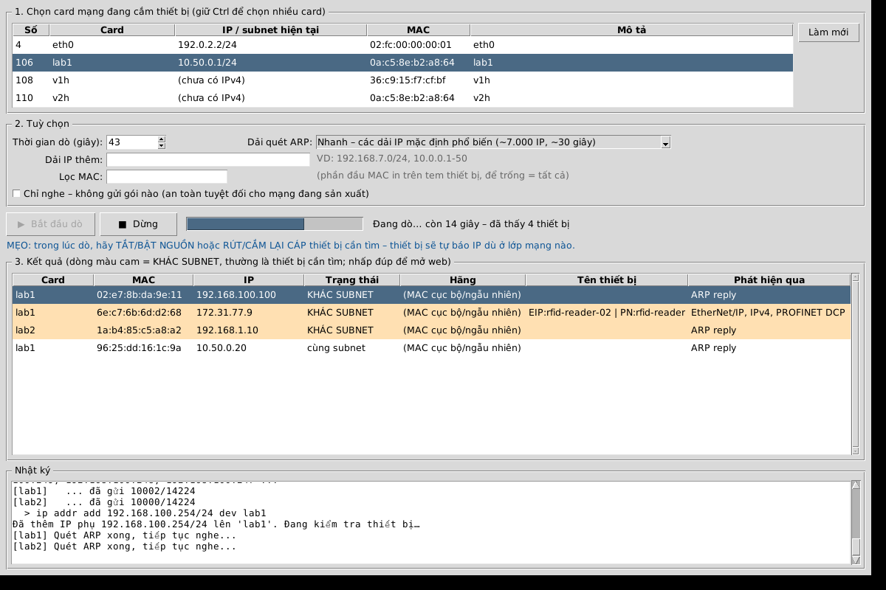

# IP Finder – dò IP thiết bị công nghiệp khi không biết IP, không reset được

Công cụ cho máy tính công nghiệp (IPC) cắm nhiều thiết bị qua Ethernet: đầu đọc mã vạch,
đầu đọc RFID, camera, PLC, module I/O... Dùng khi thiết bị cũ hoặc thiết bị lấy từ kho
**có IP không rõ**, **không có nút reset**, và IP mặc định không dùng được.

Thiết bị có IP ở **lớp mạng khác** (VD PC là `10.50.0.x`, thiết bị là `192.168.100.100`)
thì ping, Angry IP Scanner hay `arp -a` đều không thấy. IP Finder làm việc ở **tầng Ethernet (L2)**
ngay trên card mạng (NIC) cắm thiết bị, nên **không cần cùng subnet**.

## Cách hoạt động

| Kỹ thuật | Tìm được | Ghi chú |
|---|---|---|
| **Nghe thụ động** ARP / Gratuitous ARP / ARP probe | Mọi thiết bị IPv4 | Hầu hết thiết bị gửi gratuitous ARP khi **bật nguồn** hoặc **cắm lại cáp**, nên cách này bắt được IP **bất kỳ**, kể cả IP lạ nhất |
| Nghe DHCP/BOOTP | Thiết bị đang ở chế độ DHCP | Báo "DHCP – CHƯA CÓ IP" kèm hostname, vendor class |
| Nghe LLDP | Thiết bị có LLDP (PROFINET bắt buộc có) | Lấy tên, mô tả, IP quản lý |
| **PROFINET DCP** Identify All | Siemens, SICK, Balluff, Turck, Pepperl+Fuchs... | Multicast L2, trả về IP / mask / tên trạm |
| **EtherNet/IP** ListIdentity | Cognex, Keyence, Datalogic, Omron, Rockwell... | Trả về IP, tên sản phẩm, serial |
| Ping broadcast | Một số thiết bị | |
| **Quét ARP** các dải IP mặc định phổ biến (`quick`), cả `192.168.0.0/16` (`192`), hoặc dải tự chọn | Thiết bị có IP nằm trong dải quét | Thiết bị vẫn trả lời ARP dù khác subnet |

### An toàn khi máy đang chạy sản xuất

- **Không giả mạo IP** của máy khác. Gói ARP chỉ dùng IP thật của NIC hoặc `0.0.0.0` (ARP probe),
  nên **không làm hỏng bảng ARP** của PLC/thiết bị đang chạy.
- Giới hạn tốc độ gửi (mặc định 500 gói/giây, chỉnh bằng `--rate`).
- Chỉ chạy trên NIC bạn chọn. Có chế độ `--passive` (chỉ nghe, **không gửi gói nào**).
- Lệnh `access` chỉ **thêm IP phụ**, không đổi IP chính của NIC. Lệnh này **từ chối chạy** nếu subnet
  mới trùng với NIC khác (để không phá định tuyến tới thiết bị khác).

## Cài đặt trên Windows – không cần Internet, không cần Python

Gói `IPFinder-Offline-x.y.z.zip` đã chứa sẵn Python runtime và mọi thư viện. Máy đích **không cần cài Python**
và **không cần Internet**. Chạy được trên Windows 7 SP1, 8.1, 10, 11 (64-bit). Giao diện và bộ cài có
**Tiếng Việt / English / 中文**.

### 1. Tải gói offline (trên máy có Internet)
- **Releases** của repo (khi có tag `v*`), hoặc
- tab **Actions** → lần chạy CI mới nhất → *Artifacts* → `IPFinder-windows-x.y.z` (cần đăng nhập GitHub),
  trong đó có `IPFinder-Offline-x.y.z.zip`.

Nội dung gói:
```
IPFinder-Offline-1.2.0\
 ├─ IPFinder-Setup-1.2.0.exe     bộ cài (chọn ngôn ngữ khi cài)
 ├─ Download-Npcap.bat           chạy trên máy CÓ Internet để tải Npcap vào thư mục này
 ├─ README-FIRST.txt             hướng dẫn nhanh Việt / Anh / Trung
 ├─ README.md
 └─ Portable\                    bản chạy ngay không cần cài (IPFinder\IPFinder.exe, ipfinder-cli.exe)
```

### 2. Npcap – tải bản nào?
Trên trang https://npcap.com/#download, mục *Downloading and Installing Npcap Free Edition*, chọn
**“Npcap 1.90 installer”** (hoặc bản mới hơn). Đây là **một file `npcap-1.90.exe` duy nhất**, dùng chung cho
Windows 7/8/10/11, cả 32-bit, 64-bit và ARM64.
**Không** cần tải *SDK*, *debug symbols* hay *source code*.
Cách nhanh hơn: chạy `Download-Npcap.bat` trong gói offline, script sẽ tải file đó vào đúng chỗ.

- Giấy phép Npcap bản miễn phí **không cho phép đóng gói kèm**, nên gói offline không chứa sẵn Npcap.
- Bản miễn phí chỉ được cài trên **tối đa 5 máy**. Cần cài nhiều hơn 5 máy thì phải mua **Npcap OEM**.
- Nếu IPC đã cài Wireshark thì thường đã có Npcap, bỏ qua bước này. Lưu ý: Npcap chỉ được dùng không giới hạn số máy khi **chỉ** dùng với Nmap/Wireshark, nên máy nào dùng IP Finder thì vẫn tính vào giới hạn 5 máy.

### 3. Chép qua USB và cài
Đặt `npcap-1.90.exe` **cùng thư mục** với `IPFinder-Setup-1.2.0.exe`, chép cả thư mục sang máy đích rồi chạy Setup.
- Bộ cài hỏi ngôn ngữ; ngôn ngữ chọn lúc cài là ngôn ngữ mặc định của chương trình.
- Nếu máy chưa có Npcap, bộ cài **tự chạy `npcap-*.exe`** cùng thư mục (khi cài Npcap nhớ tick *WinPcap API-compatible Mode*).
- Cài xong có biểu tượng **IP Finder** trên Desktop / Start Menu. Chương trình tự xin quyền Administrator.

**Bản portable** (không cần cài): chạy `Portable\IPFinder\IPFinder.exe` (vẫn cần Npcap).

### Tự build bộ cài
Trên một máy Windows có Internet: cài Python 3.8 x64 (để hỗ trợ cả Windows 7) và
[Inno Setup 6](https://jrsoftware.org/isdl.php), rồi chạy `build_windows.bat`.
Kết quả nằm ở `dist\IPFinder-Setup-x.y.z.exe`.

### Linux / chạy từ mã nguồn
```bash
sudo pip install -r requirements.txt
sudo python3 ipfinder_gui.py      # giao diện
sudo python3 ipfinder.py          # dòng lệnh
```

## Giao diện



Đổi ngôn ngữ **Tiếng Việt / English / 中文** ở góc trên bên phải; chương trình nhớ lựa chọn. Đổi được cả khi
đang dò, kết quả không bị mất ([ảnh English](docs/screenshot-en.png), [ảnh 中文](docs/screenshot-zh.png)).

1. **Chọn card mạng** đang cắm thiết bị (giữ Ctrl để chọn nhiều card / nhiều lớp mạng).
2. Chọn thời gian, dải quét. Nếu mạng đang chạy sản xuất mà muốn an toàn tuyệt đối, tick **Chỉ nghe**.
3. Bấm **Bắt đầu dò**. **Trong lúc dò hãy TẮT/BẬT NGUỒN hoặc RÚT/CẮM LẠI CÁP thiết bị cần tìm.**
4. Dòng **màu cam = KHÁC SUBNET** thường là thiết bị cần tìm. Chọn dòng đó rồi:
   - **Truy cập (thêm IP phụ)**: tự chọn IP trống, thêm IP phụ lên card, kiểm tra thiết bị trả lời,
     rồi mở trình duyệt. Sau đó dùng web hoặc phần mềm của hãng để đổi IP thiết bị.
   - **Đổi IP (PROFINET)** / **Nháy đèn (PROFINET)**: dành cho thiết bị PROFINET.
   - Nhấp đúp để mở web, chuột phải để copy IP/MAC.
5. Xong việc bấm **Gỡ IP phụ đã thêm**. Khi thoát, chương trình cũng hỏi có gỡ không.

## Dòng lệnh (CLI)

Bộ cài có kèm `ipfinder-cli.exe` (Start Menu → *IP Finder (dòng lệnh)*), chạy trong cmd **Run as administrator**.
Chạy không tham số sẽ vào chế độ hỏi-đáp.

**Quy trình khuyên dùng khi tìm 1 thiết bị:**
1. Cắm thiết bị vào NIC của IPC (trực tiếp hoặc qua switch).
2. `ipfinder-cli ifaces` → xem số thứ tự của card.
3. `ipfinder-cli find --iface 12 --time 60`
4. **Trong lúc dò, TẮT/BẬT NGUỒN thiết bị (hoặc rút/cắm lại cáp)** → thiết bị sẽ tự báo IP.
5. Tìm dòng **KHÁC SUBNET** trong kết quả → đó thường là thiết bị cần tìm.
6. Vào được thiết bị: `ipfinder-cli access --iface 12 --ip 192.168.100.100 --apply`
   → mở web/tool của hãng để đổi IP → gỡ IP phụ bằng lệnh mà chương trình in ra.

Ví dụ kết quả:
```
NIC          MAC               IP                  TRẠNG THÁI         HÃNG / TÊN
---------------------------------------------------------------------------------------------
Ethernet 2   00:d0:24:12:34:56 192.168.100.100     KHÁC SUBNET        Cognex Corporation | EIP:DM262
Ethernet 2   00:1b:1b:aa:bb:cc 172.31.77.9         KHÁC SUBNET        Siemens AG | PN:rf-reader-02
Ethernet 2   00:01:fc:01:02:03 thử 10.11.12.13     DHCP - CHƯA CÓ IP  Keyence Corporation
Ethernet 2   00:06:77:0a:0b:0c 10.50.0.20          cùng subnet        Sick Ag
```

### Các lệnh

`ipfinder` dưới đây = `ipfinder-cli.exe` (Windows) hoặc `sudo python3 ipfinder.py` (Linux).

```text
ipfinder ifaces                                  Liệt kê NIC, IP/subnet; cảnh báo subnet trùng giữa các NIC
ipfinder find   --iface <số|tên|MAC|all> [...]   Dò thiết bị
ipfinder access --iface X --ip <IP thiết bị>     Thêm IP phụ tạm để truy cập thiết bị khác subnet
ipfinder dcp-setip --iface X --mac M --ip ...    Đổi IP thiết bị PROFINET trực tiếp (không cần cùng subnet)
ipfinder dcp-blink --iface X --mac M             Nháy đèn thiết bị PROFINET để nhận ra nó trên tủ điện
```

#### Tuỳ chọn của `find`
| Tuỳ chọn | Ý nghĩa |
|---|---|
| `--iface X` (lặp lại được), `--iface all` | Dò song song trên nhiều NIC / nhiều lớp mạng; kết quả ghi rõ NIC |
| `--time 60` | Thời gian dò (giây) |
| `--passive` | Chỉ nghe, không gửi gì (an toàn tuyệt đối cho mạng sản xuất) |
| `--preset quick\|192\|wide\|none` | Dải quét ARP. `quick` ≈ 7.000 IP (~30 giây), `192` = 65.000 IP (~4,5 phút), `wide` ≈ 390.000 IP (~26 phút), tính ở tốc độ mặc định với `--arp-src both` |
| `--range 10.20.0.0/16`, `--range 192.168.7.10-50` | Thêm dải quét |
| `--arp-src both\|own\|probe` | IP nguồn của gói ARP. Mặc định `both`: gửi cả IP thật của NIC lẫn `0.0.0.0` (ARP probe), vì thiết bị chạy Linux nhúng có bật `rp_filter` sẽ bỏ qua ARP đến từ subnet lạ, nhưng vẫn trả lời ARP probe. Dùng `own` để quét nhanh gấp đôi |
| `--rate 500` | Số gói/giây tối đa |
| `--mac 00:d0:24` | Chỉ hiện MAC bắt đầu bằng... (MAC in trên tem thiết bị) |
| `--save base.json` / `--diff base.json` | Lưu danh sách thiết bị hiện có, lần sau đánh dấu **[MỚI]** thiết bị vừa cắm vào |
| `--out ketqua.csv` / `.json` | Xuất kết quả |
| `--no-arp --no-dcp --no-enip --no-icmp` | Tắt từng kỹ thuật |

#### IPC có nhiều thiết bị trên cùng mạng

Khi switch đang có nhiều thiết bị, kết quả sẽ liệt kê tất cả. Để biết thiết bị nào mới cắm:

```bash
ipfinder find --iface 12 --time 30 --save base.json      # trước khi cắm thiết bị
# ... cắm thiết bị cần tìm ...
ipfinder find --iface 12 --time 60 --diff base.json      # thiết bị mới có nhãn [MỚI]
```

Hoặc lọc theo MAC in trên tem: `--mac 00:d0:24:12`. Cột *HÃNG* tra theo OUI của địa chỉ MAC.

## Xử lý sự cố

| Hiện tượng | Cách xử lý |
|---|---|
| Không thấy NIC / lỗi pcap / báo thiếu Npcap | Cài Npcap 1.90 (xem mục Cài đặt), chạy bằng **Administrator** |
| Windows 7 báo thiếu `api-ms-win-crt-*.dll` | Cài Windows Update KB2999226 (Universal C Runtime) – tải offline từ Microsoft |
| Thấy MAC nhưng "CHƯA THẤY IPv4" | Bật/tắt nguồn thiết bị trong lúc dò (cách chắc chắn nhất); hoặc quét rộng hơn `--preset 192` / `--range ...` |
| "DHCP – CHƯA CÓ IP" | Thiết bị đang chờ DHCP. Cần chạy DHCP/BOOTP server trên NIC đó (tool BOOTP của hãng, Tftpd64, dnsmasq) để cấp IP |
| `access` báo lỗi trên Windows | Windows chỉ cho thêm IP phụ khi card dùng **IP tĩnh**. Đặt IP tĩnh cho card trước |
| `access` báo trùng subnet NIC khác | Rút tạm cáp của NIC kia, hoặc dùng `--prefix 30` để thu hẹp subnet IP phụ |
| Thiết bị cắm qua switch có VLAN | Cắm thiết bị thẳng vào NIC hoặc vào port cùng VLAN |
| `dcp-setip` báo "Không được phép" | Thiết bị đang có kết nối PROFINET với PLC. Ngắt kết nối PLC trước |

## Công cụ có sẵn khác (tham khảo)

- [royhills/arp-scan](https://github.com/royhills/arp-scan) (Linux): quét ARP L2, `arp-scan -I eth1 192.168.0.0/16`.
- [netdiscover-scanner/netdiscover](https://github.com/netdiscover-scanner/netdiscover) (Linux): `netdiscover -p` để nghe ARP thụ động.
- **Wireshark**: lọc `arp || bootp || lldp || pn_dcp || enip` rồi bật/tắt nguồn thiết bị.
- Tool của hãng: Siemens PRONETA / Primary Setup Tool (PROFINET), Cognex DataMan Setup Tool,
  Keyence AutoID Navigator, SICK SOPAS ET, Datalogic DL.CODE, Rockwell BOOTP/DHCP Server.

IP Finder gom các cách trên vào một chương trình chạy được trên Windows, dò được nhiều NIC cùng lúc,
và có thêm bước truy cập/đổi IP.

## Kiểm thử

`tests/run_lab_test.sh` (Linux, root) tạo một mạng ảo gồm 2 NIC và 4 thiết bị giả lập
(khác subnet, ngoài mọi dải mặc định, thiết bị Linux có `rp_filter`, có PROFINET DCP / EtherNet/IP,
cùng subnet), rồi kiểm tra `find`, chế độ nghe thụ động, `access`, `dcp-blink` và `dcp-setip`.
Đặt `IPF=đường/dẫn/ipfinder-cli` để chạy cùng bộ test với bản đã đóng gói.

Mỗi lần push, CI sẽ:
- chạy bộ test trên;
- build bộ cài Windows bằng Python 3.8;
- tự kiểm tra cả hai exe (`selftest`);
- thử cài và gỡ bộ cài ở chế độ im lặng.

> Lưu ý: phần PROFINET DCP / EtherNet/IP mới được kiểm thử với thiết bị giả lập theo đặc tả,
> chưa chạy thử trên thiết bị thật.
